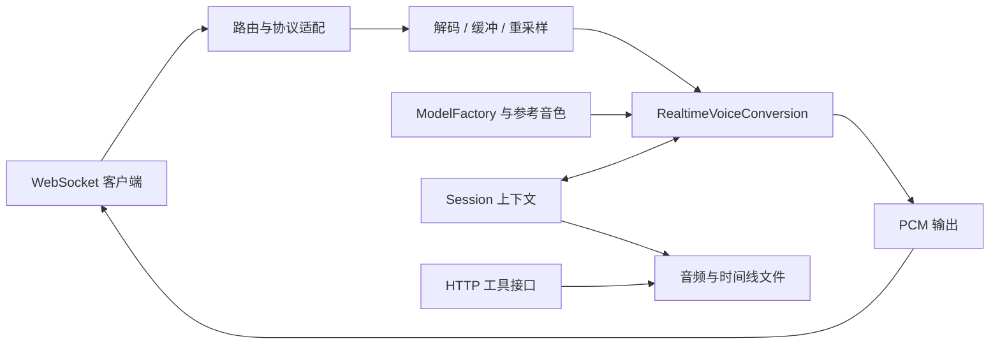

# 总体设计

## 1. 定位与能力边界

Fast-VC 将 Seed-VC 模型封装为 WebSocket 流式音色转换服务，面向需要在语音应用中收发音频流的开发者。服务提供协议适配、音频缓冲、推理编排、会话管理及输出保存。

当前入口是 FastAPI 服务和 Python 示例客户端。参考音色在服务配置中指定，在 Worker 初始化时预计算；协议没有逐请求上传或切换参考音色的字段。服务没有自带完整用户系统、管理界面或训练 API。

## 2. 模块结构

| 模块 | 职责 | 源码 |
| --- | --- | --- |
| CLI / App | 进程入口、配置、Worker 初始化、路由注册 | [cli.py](../../src/fast_vc_service/cli.py)、[app.py](../../src/fast_vc_service/app.py) |
| 路由 / Adapter | 识别两种协议、初始化会话、收发与结束 | [ws.py](../../src/fast_vc_service/routers/ws.py)、[协议适配](../../src/fast_vc_service/adapters/protocol_adapter.py) |
| Buffer | PCM / Opus 输入、分块、预填充与格式转换 | [buffer.py](../../src/fast_vc_service/buffer.py) |
| 实时推理 | VAD、上下文、F0、语义检索、转换、音量与拼接 | [realtime_vc.py](../../src/fast_vc_service/realtime_vc.py) |
| 模型工厂 | 模型加载、缓存、可选组件 | [models.py](../../src/fast_vc_service/models.py) |
| Session / Tools | 会话状态、保存、时间线与数据读取 | [session.py](../../src/fast_vc_service/session.py)、[tools](../../src/fast_vc_service/tools) |

## 3. 启动与依赖

CLI 设置配置路径，App 创建各 Worker 的服务实例，加载模型并计算参考音色后注册接口。模型工厂按所选模型获取权重、内容编码器、声码器和其他组件；首次运行可能需要下载。

`externals/seed_vc/` 是 [.gitmodules](../../.gitmodules) 中声明的子模块，提供底层模型实现。服务依赖仓库固定的子模块提交；上游新增能力不自动成为本服务接口能力。

配置加载和部署步骤见[配置与部署](../getting_started/配置与部署.md)。配置文件读取失败时当前实现会记录日志并回退默认值，部署后必须核对实际加载情况。

## 4. 并发与部署模型

Uvicorn 启动多个进程；每个 Worker 拥有自己的 RealtimeVoiceConversion 单例、模型与参考音色。App 按 Worker 标识在设备列表中循环分配设备。不同会话持有独立上下文，同一 Worker 复用模型。

推理调用位于 WebSocket 处理流程内，没有专门的动态批处理队列。增加连接或 Worker 不等于线性增加吞吐；模型驻留显存也随进程增加。

CLI 按端口记录实例 PID。当前连接监控写入相对路径 `temp/connections.json`，同一工作目录内多个服务可能共享该计数文件；PID 分离不代表所有运行文件已隔离。详见[会话与可观测性](会话与可观测性.md)。

## 5. 当前约束与演进方向

- 对外返回 16-bit 单声道 PCM，输入 Opus 不意味着输出也编码为 Opus。
- 标准协议的 api_key 校验目前只检查非空，简单协议使用内部占位值；HTTP 工具接口未实现访问鉴权。
- 历史性能报告记录了 NVIDIA GPU 结果；本次文档整理不新增平台或吞吐保证。
- 认证、运行数据隔离、客户端可复现性和指标口径存在可改进之处，具体事实见操作指南与评测文档。是否实施及方案需单独确认，不能把记录限制当作已承诺修复。

历史开发方向见[历史路线记录](archive/历史路线记录.md)，后续已确认任务进入 [todo](../todo.md)。
