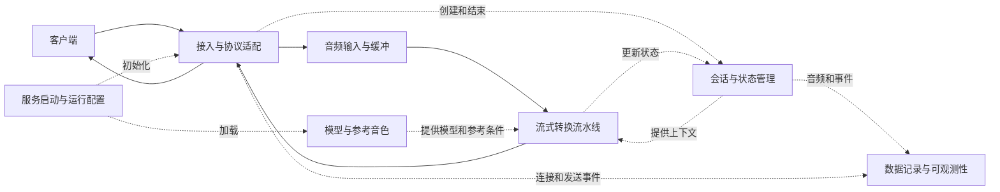

# 总体设计

## 1. 定位与能力边界

Fast-VC 将 Seed-VC 模型封装为 WebSocket 流式音色转换服务，面向需要在语音应用中收发音频流的开发者。服务提供协议适配、音频缓冲、推理编排、会话管理及数据记录。

当前入口是 FastAPI 服务和 Python 示例客户端。参考音色在服务配置中指定，在 Worker 初始化时预计算；协议没有逐请求上传或切换参考音色的字段。服务没有自带完整用户系统、管理界面或训练 API。

## 2. 模块边界

设计按七个逻辑职责组织。当前实现中，一个源文件可能承担多个模块的职责；下表描述现有代码的分工，不表示已经拆成七个独立组件。

| 模块 | 核心职责 | 主要实现 |
| --- | --- | --- |
| [服务启动与运行配置](服务启动与运行配置.md) | 加载配置，启动 App 与 Worker，分配设备，管理进程 | [cli.py](../../src/fast_vc_service/cli.py)、[config.py](../../src/fast_vc_service/config.py)、[app.py](../../src/fast_vc_service/app.py) |
| [接入与协议适配](接入与协议适配.md) | 归一化两种协议，组织收发、正常结束和异常退出，提供 HTTP 入口 | [routers](../../src/fast_vc_service/routers)、[adapters](../../src/fast_vc_service/adapters) |
| [会话与状态管理](会话与状态管理.md) | 为连接持有独立上下文，管理状态创建、更新和清理 | [session.py](../../src/fast_vc_service/session.py)、`RealtimeVoiceConversion.create_session()` |
| [音频输入与缓冲](音频输入与缓冲.md) | 解码网络音频，累计固定时长的块，执行预填充、补齐和输入重采样 | [buffer.py](../../src/fast_vc_service/buffer.py) |
| [流式转换流水线](流式转换流水线.md) | 利用会话上下文组织 VAD、音高、检索、推理与连续音频后处理 | [realtime_vc.py](../../src/fast_vc_service/realtime_vc.py) 的 `chunk_vc()` 及各处理阶段 |
| [模型与参考音色](模型与参考音色.md) | 准备模型组件、权重和参考条件，供 Worker 内会话复用 | [models.py](../../src/fast_vc_service/models.py)、`RealtimeVoiceConversion._cal_reference()` |
| [数据记录与可观测性](数据记录与可观测性.md) | 保存音频与时间线，记录日志和连接数，读取和分析运行数据 | `Session` 的记录与保存方法、`ConnectionMonitor`、[logging_config.py](../../src/fast_vc_service/logging_config.py)、[tools](../../src/fast_vc_service/tools) |

缓冲模块交付可处理的音频块，流水线负责连续转换。模型模块准备可复用资源，流水线决定每块如何调用这些资源。会话模块维护继续转换所需的状态，数据记录模块负责保存和解释运行证据。这三组边界也是专题文档的分工。

## 3. 音频主链路与支撑关系

实线表示音频主链路，虚线表示资源、状态和记录关系。一次连接的主要过程是：

1. 接入层接受连接，将首条配置消息转换为统一内部字段，创建 Session 与 Buffer。
2. Buffer 接收 PCM 或 Opus 数据，累计到推理块后输出模型前端采样率下的浮点音频。
3. 流水线读取该 Session 的上下文，调用 Worker 内模型，完成转换、拼接和输出重采样，把结果写入 `session.out_data`。
4. 接入层将输出转换为单声道 int16 PCM 字节并发回客户端；一个网络输入包可能触发零次或多次推理。
5. 正常结束走尾块处理和完成响应；其他退出路径转入清理。已记录数据的后台保存及完成语义见[会话设计](会话与状态管理.md)和[数据记录](数据记录与可观测性.md)。

HTTP 工具接口通过 `SessionDataManager` 读取已落盘数据，不参与实时音频转换。

## 4. 运行层级与资源归属

| 层级 | 持有资源 | 生命周期与共享范围 |
| --- | --- | --- |
| 服务实例 / 主进程 | 监听配置、Uvicorn 运行参数、CLI 的端口 PID 记录 | 从服务启动到退出；多个 Worker 时由 Uvicorn 管理子进程 |
| Worker 运行进程 | FastAPI App、有效配置、`RealtimeVoiceConversion` 单例、模型、参考条件、输出重采样器缓存、数据读取管理器 | 在该 Worker 初始化，供其连接复用；模型与参考条件不跨 Worker 共享内存 |
| WebSocket 连接 / 会话 | 协议适配器、Buffer、Session 的音频窗口、VAD/F0/SOLA 状态、输出数组与记录 | 初始化后逐块更新，连接退出后安排保存和清理 |

App 按 Worker 标识在设备列表中循环选择设备。推理直接发生在 WebSocket 处理流程中，当前没有专门的动态批处理队列。增加 Worker 会增加模型驻留资源，吞吐变化需要实测。

CLI 的 PID 文件按端口命名；运行文件仍存在共享范围差异，不能据此推断多实例完全隔离。配置生效与进程管理见[服务启动与运行配置](服务启动与运行配置.md)，连接统计文件的边界见[数据记录与可观测性](数据记录与可观测性.md)。

## 5. 外部依赖与当前约束

`externals/seed_vc/` 是 [.gitmodules](../../.gitmodules) 声明的 Git 子模块，提供底层模型实现。服务依赖仓库固定的子模块提交，上游能力是否可用由当前加载与推理路径决定。Python 依赖及锁定版本以 [pyproject.toml](../../pyproject.toml)、[uv.lock](../../uv.lock) 为准。

当前约束按所属模块维护：

- 协议和访问控制：[接入与协议适配](接入与协议适配.md)，包括现有认证占位逻辑与异常响应边界。
- 音频表示与格式：[音频输入与缓冲](音频输入与缓冲.md)，包括 PCM 输出和四个采样率环节。
- 模型与音色适用范围：[模型与参考音色](模型与参考音色.md)，包括启动时固定参考条件和模型兼容要求。
- 运行证据与测量限制：[数据记录与可观测性](数据记录与可观测性.md)。历史吞吐和单次试听均不能作为当前生产保证。

这些限制不自动成为已承诺的改造任务。后续已确认工作进入 [todo](../todo.md)，具体方案和验收进入 [Spec](../specs/README.md)。
